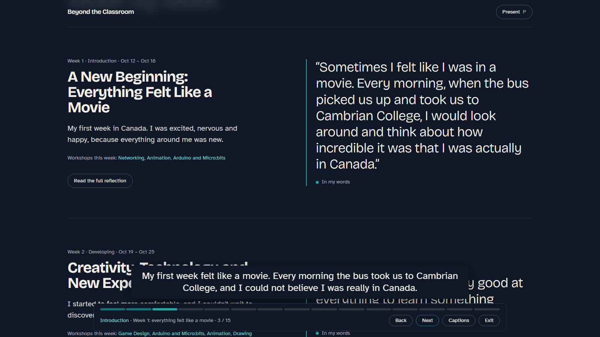

# Beyond the Classroom — My Canadian Tech Journey

An interactive academic portfolio by **Hermelinda Rojas Rubio**, an Information Technology student from Querétaro, Mexico. It documents my four weeks in the Querétaro Exchange Program at **Cambrian College** in Greater Sudbury, Ontario, Canada (October–November 2026): what I learned in each workshop, what I made, and how it felt to live it.

**Open the portfolio:** https://hermelindarr.github.io/beyond-the-classroom/



## Features

- **One reflection per week**, in my own words, with a short summary, a highlighted quote and a full reading view. Weeks 3 and 4 are added only after they happen.
- **Ten workshops**, each with its own case study built from my notes, files and photos.
- **StarFall, playable in the browser**: my first GameMaker game, rebuilt from its GML events with the same rules (60 steps per second, one star every 60 steps, random speed, tint and angle).
- **Interactive demonstrations** that explain each topic: keyframes and FK/IK rigs, the OSI model and a packet's journey, the CIA triad with a real SHA-256 fingerprint, Caesar and Vigenère ciphers from my notebook, an ultrasonic sensor and micro:bit radio, MoSCoW and weighted scoring, and the agent loop.
- **Guided presentation mode** (key **P**): 15 stops in 7:20 with on-screen English narration, a progress bar, skip and return controls, presentation-remote support (Page Up / Page Down) and an optional separate speaker-notes window (key **N**). An extended route covers every section.
- **Honest labelling** of every piece of content (see below).
- **Works offline** from a single `index.html` (no server, no internet), with keyboard navigation, visible focus, reduced-motion support and adaptive quality for low-end computers.

## Workshops

| Workshop | What the case study shows |
| --- | --- |
| Game Design | Game design theory in week 1; StarFall, started in week 2, with its code and my notes |
| Drawing and Character Development | A layered pose drawing and thumbnail sketches |
| 2D Animation in Harmony | Keyframe practice and a walk cycle on a rig |
| 3D Animation in Blender | My Harmony-to-Blender shortcut map, forward vs inverse kinematics |
| Arduino and Micro:bits | The class's ultrasonic-sensor circuit, my kit photo, micro:bit radio |
| Networking and Cybersecurity | My notes on the OSI model, the CIA triad, safe habits and ciphers |
| IT Business Analysis | Northstar, a fictional classroom case: MoSCoW, weighted scores, request flow, traceability |
| AI Agents and Generative AI | Class material only: the agent loop, anatomy of an agent, RAG, human in the loop |
| Database Fundamentals Bootcamp | Upcoming at the time of publishing |
| IoT Application Programming Interfaces | Upcoming at the time of publishing |

## What is mine and what is not

- **My work** (teal): my files, notes, photos and reflections.
- **Class material** (violet): content from the instructors, shown as context.
- **Interactive demonstration** (◇): simulations built for this portfolio to explain a topic.
- **Upcoming** (dashed): workshops that had not happened yet.

### Third-party assets in this public version

My StarFall project uses the **workshop's StarFall asset pack** for its sprites, music and sounds. Those files are not mine and their redistribution rights are not confirmed, so **this repository does not include them**. The public version uses simple original placeholders instead (a white star, a flat night sky, a ground block, an expanding-ring explosion and synthesized sounds), generated by `scripts/make-public-assets.mjs`. The game's rules and code are unchanged.

The Northstar process diagram is also replaced by a placeholder, because its authorship is not confirmed.

## Run it

**Without installing anything:** open https://hermelindarr.github.io/beyond-the-classroom/, or download this repository (**Code → Download ZIP**), extract it and open `entrega/ABRIR-PORTAFOLIO.html` in a modern browser.

**From source** (Node.js 20 or newer):

```bash
npm install
npm run dev        # development server
npx vite build     # offline single-file build in dist/
```

`public/reflections.js` (weekly reflections) and `public/media.js` (videos) are plain scripts that can be edited without rebuilding.

## Technologies

Vite 5, React 18, TypeScript, Tailwind CSS 3, GSAP with ScrollTrigger, Lenis, Three.js (opening animation), `vite-plugin-singlefile` (offline build), Fontsource fonts (Bricolage Grotesque, Atkinson Hyperlegible, JetBrains Mono; SIL Open Font License), and Puppeteer driving Microsoft Edge for end-to-end tests.

## Repository layout

```
src/        React app, StarFall engine, case-study pages and demos
public/     Editable scripts (reflections, media) and StarFall placeholder sounds
scripts/    End-to-end tests, backup-PDF generator, placeholder generator
docs/       Built site served by GitHub Pages
entrega/    Offline delivery: ABRIR-PORTAFOLIO.html, the portfolio and a backup PDF
```

## Not published

The private Spanish speaker notes, my reflection questionnaire and internal evidence reports are not part of this repository. `public/notes.es.js` is an empty template, so the speaker-notes window opens without notes, and the tests that read those notes fail in this copy.

---

© 2026 Hermelinda Rojas Rubio. Class materials and the StarFall asset pack belong to their respective owners.
